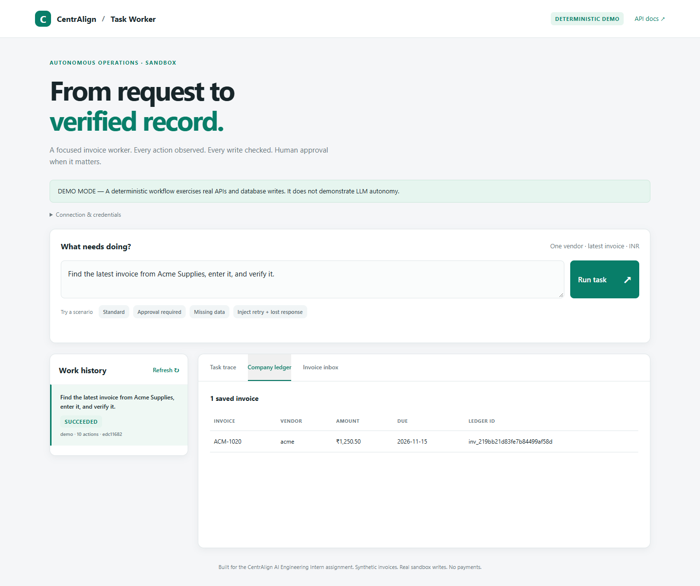
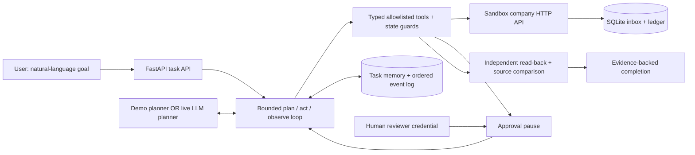

# CentrAlign · Autonomous Invoice Worker

A narrow, auditable worker that turns **“Record the latest invoice from Acme Supplies”** into a verified record in a sandbox company's internal ledger.

It performs real API calls, validates source documents, persists records in SQLite, recovers from temporary failures, pauses for human approval, and checks the saved outcome before reporting success. Synthetic data only; no payment execution.

**Three explicitly different modes:**

| Mode | Who chooses the next action? | What this demonstrates |
| --- | --- | --- |
| `demo` (default) | A deterministic, fixture-aware state machine | Working execution, recovery, approvals, persistence and verification. **Not LLM autonomy.** |
| `openai` | A real model using Responses API function calls after each observation | LLM-driven planning and tool selection, within application-enforced boundaries. Requires your API key. |
| `groq` | A real model hosted on Groq using Chat Completions tool calls | Free-tier option subject to the account's quotas. Uses a Groq key; no OpenAI key required. |

No silent fallback between modes. The UI and every task record show the mode. Automated provider tests use scripted HTTP responses; those are **contract tests, not evidence of live model intelligence**. See [validation evidence](docs/VALIDATION.md) for what was actually run.

**Want a free hosted LLM?** Follow the [Groq setup guide](docs/FREE_LLM.md). This mode is implemented with real tool execution; it is not the deterministic demo. Keep your Groq account on its Free plan to use its no-cost quotas. Free-tier limits and eligibility are controlled by Groq and can change.

**Included proof:** [recorded browser demo](docs/assets/demo.webm), [offline video player](docs/demo.html), [10-scenario evaluation](docs/evaluation.json), and [actual exported task traces](examples/evidence/summary.json). The video demonstrates deterministic decisions with real sandbox actions, including retries, duplicate protection and human review.

**Final validation:** **127 tests passed**, **89.6% coverage**, and **10/10 deterministic reliability scenarios**. Lint and formatting passed. Separate [actual live Groq evidence](examples/live-evidence/manifest.json) shows a human-approved write, repeated requests verifying the same record, and missing-data blocking. See the [final check report](docs/final-checks/report.json) for provenance; scripted provider tests and the deterministic score are not a live-model autonomy benchmark.

**Submitting this assignment?** Start with the [submission guide](docs/SUBMISSION_GUIDE.md), [live demo sequence](docs/DEMO_SCRIPT.md), [form-answer drafts](docs/FORM_ANSWERS.md) and [interview walkthrough](docs/INTERVIEW_PREP.md). `VERIFY.ps1` reproduces the checks; `RUN.ps1 -Mode groq -Fresh -Faults` starts a separate fresh sandbox for recording. A published repository and shareable live recording URL must still be supplied by the applicant.



## Run in five minutes

Requires Python 3.11+ (Python 3.12 recommended). No Node.js, browser installation, API key or paid service needed for the default demo.

```powershell
# Windows PowerShell, from this repository
python -m venv .venv
.venv\Scripts\python -m pip install -r requirements.lock
.venv\Scripts\python -m pip install --no-build-isolation --no-deps -e .
Copy-Item .env.example .env
.venv\Scripts\python -m worker
```

```bash
# macOS / Linux
python3 -m venv .venv
.venv/bin/python -m pip install -r requirements.lock
.venv/bin/python -m pip install --no-build-isolation --no-deps -e .
cp .env.example .env
.venv/bin/python -m worker
```

Open **[http://127.0.0.1:8000](http://127.0.0.1:8000)**. API explorer: [http://127.0.0.1:8000/docs](http://127.0.0.1:8000/docs). The SQLite database and seeded inbox are created automatically. Keep a single server process; do not use multiple workers or development reload during a task.

The lockfile captures the tested dependency versions. Alternatively, `pip install -e ".[dev]"` resolves compatible dependency ranges. Standard Python installations include pip; if your environment omits it, install pip using your Python distribution's documented setup.

### Try these requests in order

1. **“Find the latest invoice from Acme Supplies, enter it into our internal system, and verify it.”** It chooses October's invoice, saves INR 1,250.50 due 2026-11-15, then independently reads it back.
2. Repeat the request. The ledger still has **one** Acme record; the worker verifies the existing entry.
3. **“Record the newest invoice from Orbit Cloud.”** INR 12,500 exceeds the INR 5,000 default threshold. Inspect the exact staged amount, due date and source hash; click **Approve & resume** or **Reject**.
4. **“Record the latest invoice from Broken Labs.”** The missing due date causes a request for input, with no write. Edit the request and use **Clarify using request above** to restart with an audit trail.
5. Set `ENABLE_FAULTS=true`, restart, and use **Inject retry + lost response** before recording an invoice on a fresh database. The trace shows a retried read and a retried post-commit write; the ledger has one entry.

“Latest” means greatest invoice **issue date**, not receipt time. A tie requires clarification. Demo mode requires a full vendor name, a latest/newest phrase, and a record/save/enter/import/log intent; it is deliberately limited rather than pretending to understand arbitrary language.

## Enable real LLM decisions

For the free-tier alternative, set `WORKER_MODE=groq`, `GROQ_API_KEY`, and `GROQ_MODEL` as explained in [FREE_LLM.md](docs/FREE_LLM.md). The OpenAI configuration below is optional.

In `.env`, set:

```dotenv
WORKER_MODE=openai
OPENAI_API_KEY=your-own-key
OPENAI_MODEL=gpt-4.1-mini
```

Restart the server, check the **LIVE LLM MODE** banner, and submit a new task. Choose a Responses API model with function calling available to your account; the model is configurable, and availability/cost depend on your account. Requests transmit the task and synthetic invoice/tool observations to the configured provider. Keys and reviewer credentials are never included in the model prompt or audit export. The server sends the provider credential only in its authorization header.

The adapter uses strict function schemas, one tool call per turn, bounded HTTP retries, `store=false`, and replayed call/output history. It records token usage. A refusal, malformed output, provider error or step limit stops execution; it never changes to demo mode. The LLM decides a plan and subsequent tools; deterministic code owns money parsing, policy and success criteria. See the [official function-calling documentation](https://developers.openai.com/api/docs/guides/function-calling).

**Live Groq runs have been performed and their evidence is included.** The OpenAI adapter has been contract-tested, but no actual OpenAI provider run is claimed. Inspect the [live evidence manifest](examples/live-evidence/manifest.json) and record your own reviewed demonstration. Do not present the deterministic demo or scripted provider tests as live-model evidence.

## Architecture



The worker calls real FastAPI company routes using HTTPX's in-process ASGI transport. This runs routing, HTTP validation, authorization, policy and durable SQLite writes without a fragile second server. It is **not remote ERP integration or browser computer use**. The company API is also mounted at `/company` for independent inspection. The demo CLI and UI use actual localhost network requests. An optional Playwright script exercises the real browser UI; it does not choose the agent's actions.

| Component | Responsibility |
| --- | --- |
| `worker/planner.py` | Interchangeable decision makers; strict tool schemas and live provider transport |
| `worker/engine.py` | Plan/act/observe loop, guards, bounded retry/backoff, checkpoints and completion criteria |
| `worker/company.py` | Sandbox application endpoints, transaction-protected writes and independent approval enforcement |
| `worker/domain.py` | Exact decimal-to-minor-unit parsing, dates, canonical payload and SHA-256 fingerprint |
| `worker/store.py` | SQLite persistence, event sequence, seed fixtures and crash recovery |
| `worker/api.py` | Task lifecycle, human review, clarification, evidence export and local dashboard |
| `scripts/` | Network demo, reliability evaluation and optional browser demo recording |

### Reliability decisions worth reviewing

- **Idempotency:** a database unique constraint on `(vendor_id, invoice_number)` prevents duplicate records even when the caller loses a response. Identical content returns the existing record; changed content with that business key is blocked. Fingerprints include source identity and the entire source body hash, so even a note change conservatively requires reconciliation.
- **Approvals:** amounts **above** 500,000 INR minor units require a separate reviewer credential. Decisions bind task ID and exact canonical fingerprint. The company API rechecks the database approval even if a planner forges `approved=true` in memory. Source changes invalidate review; rejection stops the task. Clarification supersedes prior grants for that task.
- **Verification:** success requires a fresh ledger GET and source GET, a latest-source check, equality of all eight canonical fields and the stored fingerprint. The executor then completes the task and generates the summary from those fields, without another model request. An existing row alone is insufficient. Resuming an older verified checkpoint repeats these reads before completing.
- **Recovery:** transient 429/502/503/504 and network failures get bounded retries with exponential delay. The same business key makes post-commit retries safe. Permanent errors stop; bad source data asks for input. On startup, unfinished tasks become `interrupted`; explicit resume reconciles the ledger before continuing.
- **Free-tier pacing:** Groq's remaining-quota and reset headers can defer the next model call, shared across tasks in the local worker. Each wait is audited. Automatic waits are capped at 60 seconds; longer cooldowns require a later resume. This reduces avoidable quota errors without promising uninterrupted free access.
- **Memory:** current goal, vendor, source, plan, prepared payload, observations and evidence are checkpointed in SQLite. Live mode also persists tool call/output history. No vector database is needed for this short workflow.
- **Boundaries:** no arbitrary URL, shell, filesystem, payment or approval tool is exposed to the model. Invoice text is untrusted data, rendered safely in the dashboard. This constrains impact; it is not a complete prompt-injection defense or proof of semantic goal alignment.

Full rationale, state transitions, failure semantics and security assumptions: [architecture notes](docs/ARCHITECTURE.md). To learn the implementation step by step: [engineering walkthrough](docs/WALKTHROUGH.md).

## Test and evaluate

Use your environment's Python executable below (`.venv\Scripts\python` on Windows or `.venv/bin/python` on Unix).

```bash
python -m pytest --cov=worker --cov-report=term-missing
ruff check .
ruff format --check .
python -m scripts.evaluate --out artifacts/evaluation.json
```

Tests cover latest-invoice selection, exact money handling, duplicate/concurrent submissions, before/after-commit failures, bounded retries, recovery across restart, approval/rejection, stale source data, forged approval memory, verification mismatch, missing fields, clarification, unsupported requests, schema guards, API authorization and the Responses HTTP contract. The deterministic injection test verifies that application approval controls survive hostile source text; **it does not measure whether a live model resists injection**.

The evaluation runner uses fresh temporary databases and checks expected outcome, record count and evidence across ten named scenarios. It is a deterministic reliability evaluation, not an LLM benchmark. CI runs tests, formatting and lint on Python 3.11–3.13; CI results are only known once the workflow actually runs on GitHub.

### CLI and network demo

With the server running in another terminal:

```bash
python -m worker.cli run "Record the latest invoice from Acme Supplies."
python -m worker.cli show TASK_ID
python -m worker.cli review TASK_ID approve --reviewer "Your name"
python -m worker.cli export TASK_ID --out artifacts/task.json
python -m scripts.demo --out artifacts/demo
```

For a **fresh demo database**, use a new `WORKER_DB` filename and restart. To include recovery, enable faults and run `python -m scripts.demo --faults`. To explicitly let the script approve the synthetic Orbit invoice, add `--approve-demo`; otherwise the script leaves it waiting for a human. No normal agent tool can approve it.

Optional browser proof and recording:

```bash
pip install -e ".[browser]"
python -m playwright install chromium
python -m scripts.browser_demo --out artifacts/browser
```

This captures the real UI, asserts a successful task and saves a screenshot and WebM. Use `--channel msedge` for installed Microsoft Edge instead of downloaded Chromium (video still needs Playwright's FFmpeg). A clean database gives the clearest recording. [Demo narration and submission checklist](docs/DEMO.md).

## Docker

```bash
cp .env.example .env
docker compose up --build
```

The container runs as a non-root user, publishes only to localhost, and uses a named SQLite volume. Stop with `docker compose down`; the named volume retains records. Set a new `WORKER_DB` filename for another demo. Docker configuration is supplied; see validation notes for whether Docker was available and actually built in the authoring environment.

## API at a glance

Use `Authorization: Bearer local-worker` for worker operations; reviewer operations require `Bearer local-reviewer`. Override both defaults in `.env`. OpenAPI's individual endpoints accept an `authorization` header in “Try it out.”

| Endpoint | Behavior |
| --- | --- |
| `POST /api/tasks` `{ "goal": "..." }` | Executes synchronously until success, pause or failure; returns task and memory |
| `GET /api/tasks/{id}` / `/events` / `/export` | Inspect status, ordered trace or evidence bundle |
| `POST /api/tasks/{id}/review` | Reviewer-only `{ "decision": "approve" or "reject", "reviewer": "Name", "note": "..." }` |
| `POST /api/tasks/{id}/clarify` | Updated goal; restart checkpoints, supersede previous approvals, retain audit events |
| `POST /api/tasks/{id}/resume` | Resume interrupted/failed work if step budget remains |
| `GET /api/records` / `/inbox` / `/approvals` | Inspect sandbox data |
| `POST /api/faults` | Reviewer-only, opt-in fault injection; see OpenAPI for names |

## Assumptions, tradeoffs and limits

This is a **local, single-user, single-process sandbox prototype**, not production accounting software. Tokens are shared development credentials, not user identities or RBAC; the reviewer name is an audit label. Do not expose it publicly with the defaults. Browser inputs keep tokens in memory and use safe DOM text rendering. Logs contain synthetic invoice content; real deployment would need retention and redaction rules.

Inputs are seeded, labeled plain-text invoices in English and INR. There is no OCR, PDF/email connector, vendor onboarding, tax calculation, currency conversion or real ERP. Missing/conflicting fields require corrected source data; clarification does not invent a due date. Edit fixtures **before first startup** or use a fresh database; seeding is insert-only. Direct database editing while a task runs is unsupported. Code checks source freshness at preparation, review, write and verification, but this is not a distributed document-versioning system.

The runner serializes tasks and HTTP task creation is synchronous; a disconnected client should inspect persisted tasks before resubmitting. There is no durable queue, distributed lease, cancellation, automatic restart scheduling, or hard global wall-clock/spend limit. The 24-action budget and per-request timeouts bound ordinary runs, not total external cost; provider retry latency and token usage can vary. Live context grows across the bounded run. Resumes preserve remaining step budget; clarification begins a fresh budget and preserves historical events.

The live model can choose the wrong vendor or ask unnecessary questions. Code protects supported fields and write policy but cannot prove that a model's vendor selection reflects arbitrary user language. Review the trace. Verification is an independent API read path over the same sandbox database, not a separate external reconciliation service. Evidence hashes detect content differences; events are locally editable by a database administrator and are not tamper-proof. Some checkpoint/event writes are separate transactions, so a crash can leave an audit gap; business-key uniqueness still protects the ledger.

Next steps: run a labeled live-model evaluation over varied paraphrases and adversarial invoices; add durable job leases and cancellation; ingest versioned documents; add role-based review with scoped identities; integrate one real test ERP API; introduce strict spend/time budgets and signed evidence.

## Prepare your GitHub submission

The folder is ready to become a repository. No remote repository has been created or published automatically.

```bash
git init
git add .
git commit -m "Build auditable autonomous invoice worker"
# Create an empty repository in your own GitHub account, then:
git remote add origin YOUR_REPOSITORY_URL
git branch -M main
git push -u origin main
```

Keep `.env`, SQLite files and generated personal evidence out of Git. Record a short live demo, attach its link to this README, and add an exported **live LLM** trace if claiming model autonomy. Include the supplied validation report without suggesting that unrun GitHub CI, Docker builds or live-model checks have passed.

Built with Python, FastAPI, SQLite, HTTPX, Pydantic, vanilla HTML/CSS/JavaScript, pytest and Ruff. Optional Playwright provides browser evidence. OpenAI Responses and Groq Chat Completions are implemented live-provider adapters; their HTTP contracts and history formats differ. Custom base URLs must implement the selected provider's contract. No LangChain/agent framework or external memory service is required. AI coding assistance was used to build the prototype; use the walkthrough to understand, explain and modify it yourself.
