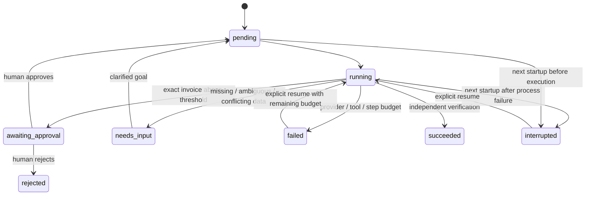

# Architecture and engineering decisions

## What “autonomous” means here

In live mode a model receives the user's goal and available tool schemas. It emits one function call. The executor validates the arguments and current state, executes the real tool, returns its observation with the matching `call_id`, and asks for the next decision. The model can ask for clarification and adapt to observations. There is no prewritten live-mode tool sequence in the runner. The system prompt suggests a sensible sequence; application guards constrain allowable transitions.

The demo planner encodes that sequence as a state machine and uses substring matching for the vendor/intent. It exercises the same tools and persistence but is intentionally not advertised as autonomous reasoning. Changing vendors and invoice counts reuses all execution code; adding unrelated workflows needs new tools and domain validation.

## State machine

Clarification also works for awaiting approval, failed and interrupted states. It resets operational memory, updates the persisted goal, invalidates prior pending/approved grants and retains all events. Rejected tasks stay rejected; a new request requires a new task.

## Trusted and untrusted components

- **Untrusted:** natural-language input, model choices/arguments, invoice body/subject, and provider response formatting.
- **Trusted within this sandbox:** code, configuration, seeded vendor identities, strict source parser, company API policy, SQLite transactions and reviewer credential holder.
- The model has only 12 typed tools. It never receives API keys or credentials. It cannot call the reviewer endpoint, choose URLs, execute code or change configuration.
- `approved` in task memory is a convenience for planning. The authoritative approval is a database row matching task ID and the exact payload fingerprint.
- Possession of the worker token permits tasks and reads, not approvals. Possession of the reviewer token permits review and fault injection, not general worker operations. This is separation of development credentials, not production authentication.
- Prompt text labels invoice contents as data, but prompt wording alone is insufficient. Financial fields come from deterministic validation; required policy and verification checks run in code. Semantic goal-to-vendor correctness remains a live-model evaluation concern.

## A complete successful trace

1. `set_plan` records a visible action plan (not private chain of thought).
2. `discover_vendors` reads the real company vendor API.
3. `select_vendor` must reference a discovered ID; the vendor stays fixed for the run.
4. `search_invoices` observes dated metadata for that vendor.
5. `read_invoice` may read only a listed invoice.
6. `prepare_invoice` requires a unique latest source; validates identity, amount, currency and dates; checks that the source has not changed.
7. `lookup_record` checks the business key. Identical existing content can proceed to verification; conflicting content pauses.
8. `request_approval`, when needed, persists an exact-fingerprint pending decision and pauses the loop.
9. `record_invoice` checkpoints preparation before POST. The company API reloads source data and task state, validates the latest invoice, checks duplicate lookup and the authoritative approval, then writes under `BEGIN IMMEDIATE`.
10. `verify_record` independently GETs ledger and source, compares every canonical field and hash, and rechecks that the invoice is latest.
11. The executor marks the task successful immediately after successful verification. The summary comes from verified fields, without a final model request. The guarded `finish` tool remains for compatibility. An older verified checkpoint is re-read on resume before the executor completes it, even if the model provider is unavailable.

SQLite stores integer **minor units**. Parsing uses `Decimal` and rejects more than two decimal places, zero/negative amounts and scientific notation. Display formatting uses minor units; financial equality does not use floats. All timestamps are UTC ISO strings; invoice dates are calendar dates without timezone conversion.

## Post-commit ambiguity

Suppose the ledger commits a write but the response is lost. Blindly creating another record would duplicate the invoice. Here, the unique business key rejects a second insertion; identical content returns the original ID. A retry can then verify the saved record. If every response is lost, the task reports failure rather than claiming success. An explicit resume first looks up the ledger and then verifies it.

This is at-least-once tool invocation with idempotent business effects, **not an exactly-once distributed execution guarantee**. If adapted to an external ERP, that ERP must provide an atomic idempotency key or equivalent constraint; checking for duplicates before a non-idempotent POST is insufficient.

## Failure classification

| Failure | Response |
| --- | --- |
| Temporary inbox/ledger outage or supported transient status | Up to 3 attempts; exponential backoff, each failed attempt audited |
| Lost response after commit | Retry same source/business key, retrieve existing row, then read back |
| Unsupported action / invalid tool arguments / wrong state | Reject action; return observation so live planner can adapt; bounded by 24 total actions |
| Invalid amount/date/currency, missing field, latest tie or duplicate conflict | `needs_input`; no fabricated values |
| High amount | `awaiting_approval`; neither retry nor model can grant permission |
| Changed source during approval | Review HTTP 409; reviewer must clarify/restart against current data |
| Verification mismatch | `needs_input`; saved row may exist, but task is not successful |
| Provider 400/401/403 / malformed or incomplete function call | Fail explicitly, no demo fallback; provider bodies are not persisted |
| Process interruption | Startup marks unfinished tasks; human may resume; reconcile uncertain writes |

Provider transient retries are bounded inside the adapter; their intermediate attempts are not separate tool events. The final provider error and per-completed-turn token usage are stored. This is a known observability gap to improve. Tool attempts include elapsed time, argument validation, result and error type/status. Action history and memory are persisted locally, not printed as model reasoning.

## Why these tradeoffs

**API execution over browser-driven data entry:** the assignment permits APIs/simulated company apps. API actions give stable failure semantics and atomic idempotency, making the narrow workflow demonstrably reliable. The optional browser script proves the review UI works, but is not the task executor. Supporting arbitrary desktop applications would add fragility without improving this workflow.

**In-process ASGI HTTP transport:** makes the company boundary independently callable and testable while keeping installation to one process. It executes real routes and real database mutations, without pretending to be a remote service. Replacing the transport with a scoped remote client is a contained integration change.

**SQLite plus JSON checkpoints:** enough for bounded task memory and reproducible local evidence. WAL and write transactions protect the ledger. An in-process lock serializes execution; this is not a distributed lock. Only one server process is supported.

**Strict parser over unconstrained extraction:** removes hallucinated financial fields from the write path. The cost is a deliberately narrow text format. A future OCR/extraction model should produce candidate data whose values are tied to source spans and validated before approval.

**Evidence-based finish:** an action's success response is not the outcome. Reading back the saved row catches mismatches and supports reviewer inspection. It is still the same application's database; production reconciliation should verify against the actual external system and durable document versions.

## Concurrency, crashes and limits

The engine lock covers each execution and human state mutation. Database uniqueness protects the business key even outside that lock. The task API waits for execution; there is no job broker. A crash between ledger commit and checkpoint/event persistence can leave an incomplete trace; explicit lookup on resume handles the business effect. SQLite events are ordered but not immutable or cryptographically signed.

Configured tool/step limits prevent unbounded action loops. Each provider call has a timeout and maximum output token count, but there is no cumulative spend cap or hard overall execution deadline. Live-model performance, prompt-injection resilience, public hosting, multi-user authorization and distributed recovery require additional evaluation and engineering.
